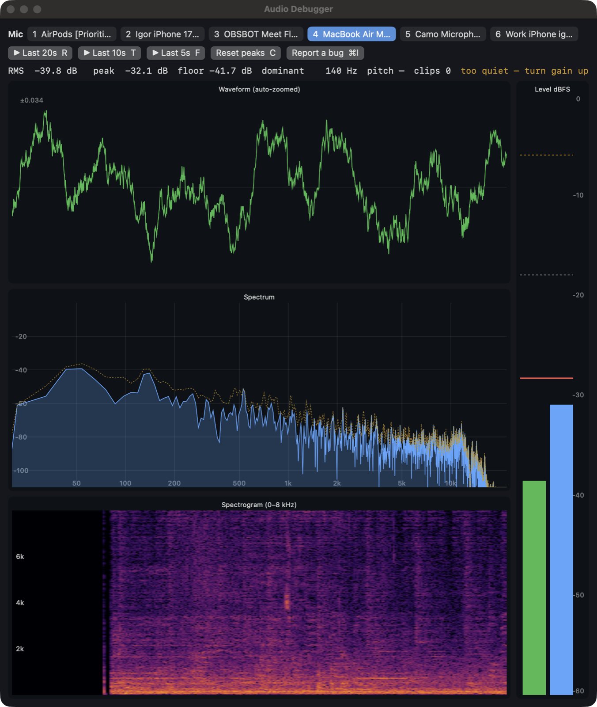
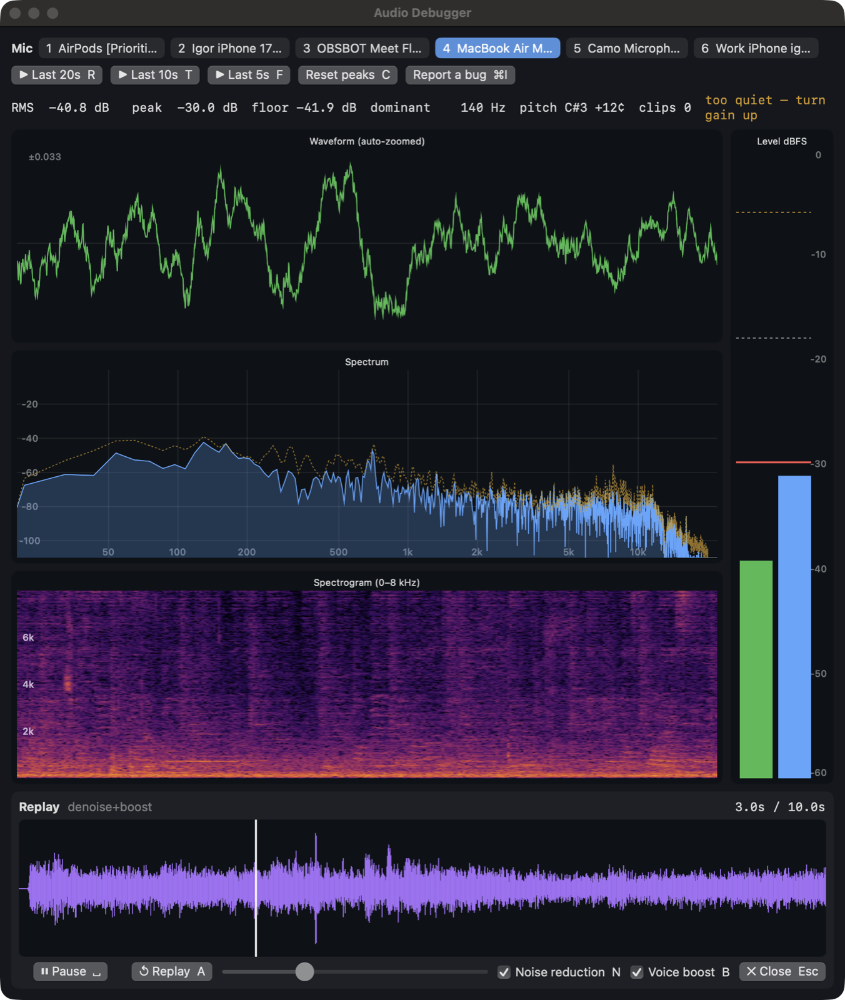

# Audio Debugger

A native macOS app for finding out how a microphone actually sounds: see the signal live, then hear the last
20 seconds back, cleaned up, without ever pressing record.



## What it shows

- **Every mic as a button** (keys 1–9). The choice is remembered and comes back when a USB mic is re-plugged; it
  never opens AirPods by accident (that drops them into call-quality mode, music and all).
- **Waveform** scaled to its own peak, so a quiet mic still fills it.
- **Spectrum** (log frequency, dBFS, with a decaying peak line) and a **0–8 kHz spectrogram** for hum, hiss and
  the shape of your voice.
- **Level meter**: RMS and peak, the held peak, guides at -18 and -6 dBFS.
- **Status line**: RMS, peak, noise floor, dominant frequency, pitch as a note (`A2 +3¢`), clipped samples, and a
  gain hint ("too quiet — turn gain up").

## Hearing it back



The last 20 seconds are always kept. **R / T / F** replay the last 20 / 10 / 5 s (Space with nothing open).

- **Space** pauses and resumes, **A** starts over, **← / →** jump a second (⇧ for five); click or drag the
  waveform, or use the scrubber.
- **Noise reduction (N)**: spectral gating, with the noise profile learned from the quietest moments of the clip.
- **Voice boost (B)**: voice band only (90 Hz–7.5 kHz), speech brought to -16 dBFS, peaks soft-limited.
- Toggle either while it plays: it keeps your place, so you can A/B the difference.

On a hissy mic, the two together raise the voice above the hiss between words by more than 15 dB (a host test).

## Bug reports

**⌘I**, a sentence, Return: the report keeps the last 20 seconds the mic heard (a WAV), the session log, the mic's
readings and the replay's state, through [BugKit](https://github.com/idvorkin/bug-kit). Nothing leaves the Mac;
the bug-kit listener files it as a bead. **⇧⌘N** shows what's new.

## Build and run

Needs macOS 14+, the Command Line Tools (Swift 6) and [just](https://github.com/casey/just).

```bash
just run          # build, sign, open (asks for the microphone once)
just test         # host tests for the DSP core
just selftest     # the replay flow, scripted and muted, verified from the log
just screenshots  # regenerate the two images above
```

See [AGENTS.md](AGENTS.md) for the architecture and [docs/stories](docs/stories/README.md) for the spec and the
full key table.
